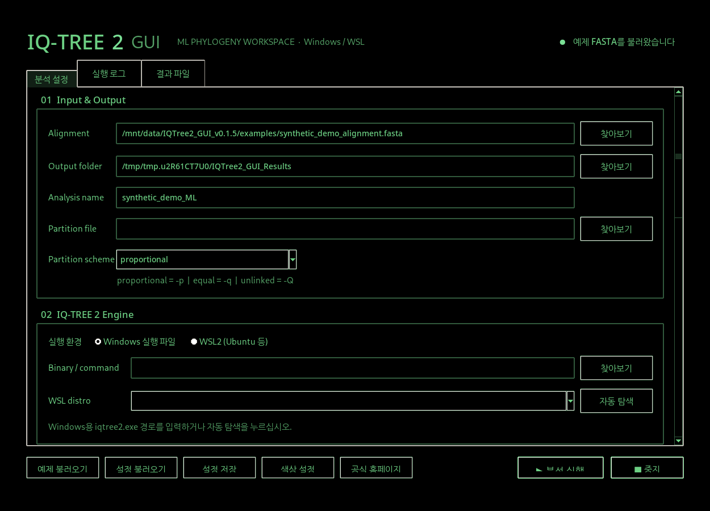
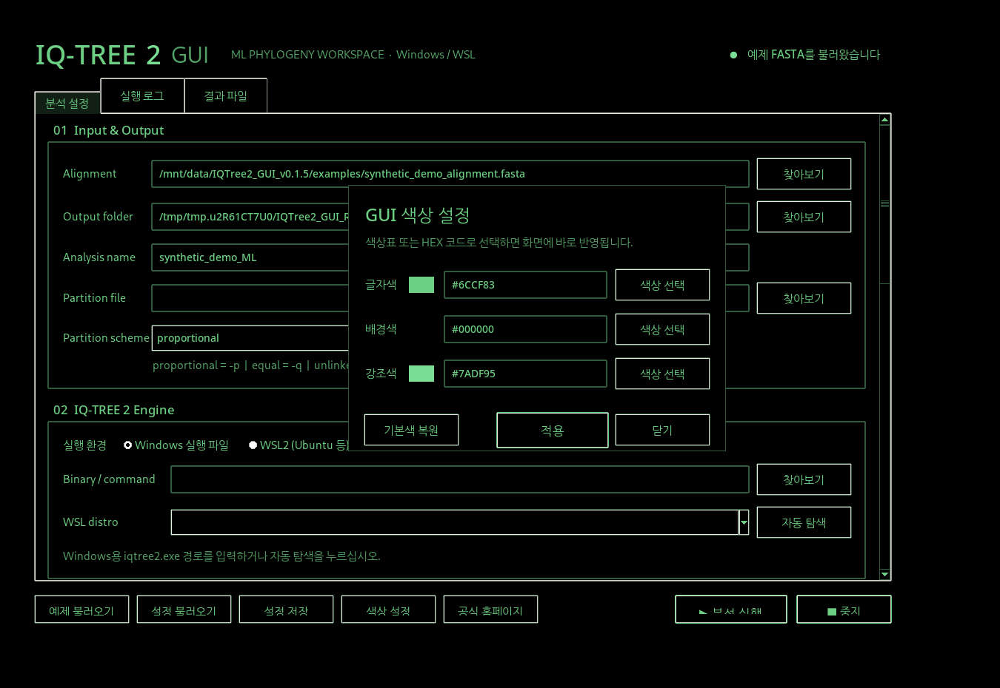
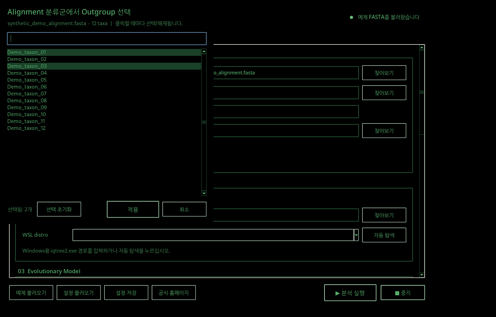

# IQ-TREE 2 GUI v0.1.5 — 사용자 지정 색상 테마

**IQ-TREE 2의 분석 옵션을 마우스로 설정하는 비공식 데스크톱 GUI**입니다. Python 표준 라이브러리(Tkinter)만 사용하며, Windows용 IQ-TREE 2 또는 Windows의 WSL2에 설치한 IQ-TREE 2를 실행할 수 있습니다. 모델 탐색, 계통수 추정, branch support 계산은 **진짜 IQ-TREE 2 바이너리**가 수행합니다. 이 GUI 자체는 분석 알고리즘을 재구현하지 않습니다.







## 새 기능: GUI 색상 직접 선택 (v0.1.5)

- 메인 창 아래의 **색상 설정** 버튼을 클릭하십시오.
- **글자색 / 배경색 / 강조색** 각각에 대해 **색상 선택** 버튼을 누르면 운영체제의 색상 선택기가 열립니다.
- 원하는 HEX 코드를 직접 입력해도 됩니다. `#69C47D` 또는 `69C47D` 모두 지원합니다.
- 선택 결과는 즉시 GUI 전체에 반영됩니다. **기본색 복원** 버튼으로 원래 녹색/검정색 테마로 돌아갈 수 있습니다.
- 색상은 사용자 설정 파일(`~/.iqtree2_gui_settings.json`)에 저장되어 다음 실행 시 유지됩니다. **설정 저장**으로 내보낸 JSON에도 테마가 포함됩니다.
- 로그, 체크박스, Outgroup 선택창, 계통수 미리보기까지 화면 색상이 반영됩니다. **SVG 내보내기는 논문용 흰 배경을 유지합니다.**
- 기존의 분석 중 상태 표시등 **600ms 점멸**, 체크박스의 **✓ 표시**, alignment 기반 **Outgroup 복수 선택** 기능도 유지했습니다.

**v0.1.3 개선:** 체크박스를 단색 채우기 대신 실제 ✓(V자) 표시로 변경하고, 전체 GUI 기본 글꼴 및 명시적으로 지정된 글꼴을 각각 1포인트 키웠습니다. **05 Performance & Advanced → Outgroup taxa → Alignment에서 선택**을 누르면 불러온 FASTA/PHYLIP/NEXUS에서 분류군을 검색하여 복수 선택할 수 있습니다. 선택한 분류군은 쉼표로 묶어 `-o`에 전달됩니다. 체크하지 않으면 outgroup은 지정하지 않습니다. 분석 파일을 변경할 때 이전 파일의 outgroup 지정은 초기화됩니다. 일부 비표준 alignment의 이름을 읽을 수 없다면 Outgroup 필드에 직접 입력할 수 있습니다.

**초기 테마:** GUI 배경 `#000000`, 기본 글자 `#6CCF83`, 강조 색상 `#7ADF95`입니다. 원하는 색으로 변경할 수 있습니다.

## 1. 윈도우에서 실행하기

1. 이 저장소의 ZIP 압축을 풀거나 GitHub 저장소를 클론합니다.
2. **Python 3.10 이상**을 설치합니다. [Python 다운로드](https://www.python.org/downloads/windows/) — Tkinter는 일반 Windows Python 설치에 포함됩니다.
3. `start_windows.bat` 파일을 더블클릭합니다. 처음 실행 후 `예제 불러오기`를 클릭하면 테스트용 가상 서열을 불러옵니다.
4. IQ-TREE 2 실행 파일이 없다면 [IQ-TREE 공식 사이트](https://iqtree.github.io/)에서 **IQ-TREE 2.4.0 Windows 64-bit**를 받으십시오. 다운로드한 압축 파일의 `iqtree2.exe` 경로를 GUI의 **02 IQ-TREE 2 Engine → Windows 실행 파일 → 찾아보기**에서 지정합니다. 혹은 GUI 프로그램 폴더 안에 `bin/iqtree2.exe`를 넣습니다.
5. `Alignment` 파일(FASTA / PHYLIP / NEXUS 등), `Output folder`, `Analysis name`을 지정하고 아래쪽 **분석 실행** 버튼을 누릅니다.
6. **실행 로그** 탭에서 진행 상황을 보고, 완료되면 **결과 파일** 탭에서 `.treefile` / `.iqtree` / `.log`를 엽니다.

**Python 설치 없이 실행되는 Windows EXE를 만들려면** `build_windows_exe.bat`를 한 번 실행하십시오. PyInstaller가 설치된 후 `dist/IQTree2_GUI.exe`가 생성됩니다. EXE 생성 자체는 Windows에서 수행해야 합니다. `.github/workflows/build-windows.yml` 파일을 GitHub Actions에서 실행하면 Windows EXE를 아티팩트로 받을 수도 있습니다. 소스 ZIP에는 미리 빌드된 EXE나 IQ-TREE 실행 바이너리가 들어 있지 않습니다.

> 배포용 EXE에는 `예제 불러오기`를 위한 synthetic FASTA를 포함하지만, 별도의 IQ-TREE 2 엔진 설치가 있어야 실제 분석을 실행합니다.

## 2. WSL2 (Ubuntu 등)에서 IQ-TREE 2 사용

1. **실행 환경: `WSL2`**를 선택합니다.
2. `자동 탐색` 버튼으로 설치된 배포판 이름을 가져오거나 `WSL distro` 필드에 `Ubuntu-22.04`처럼 입력합니다. 공란이면 기본 배포판입니다.
3. `Binary / command`를 `iqtree2`로 지정합니다. IQ-TREE가 환경변수 `PATH`에 없으면 `/home/tax/.../iqtree2`처럼 **WSL 내부 절대 경로**를 입력합니다.
4. Windows에서 찾기 버튼으로 선택한 FASTA/partition/결과 폴더 경로를 WSL의 `wslpath`로 변환한 뒤, WSL 안에서 IQ-TREE를 실행합니다.

`wsl.exe`, `/bin/bash`, `wslpath`, IQ-TREE가 실제로 WSL 배포판에서 동작해야 합니다. GUI는 Windows에서 실행하며, WSL용 GUI 설치는 필요하지 않습니다. **WSL 중지 기능**은 GUI가 확인한 Linux PID에 종료 신호를 보내도록 작성했지만, 장기간 분석에는 실제 환경에서 종료·checkpoint 동작을 확인하기를 권장합니다.

## 3. 제공 기능

| 분류 | 지원 범위 |
|---|---|
| 입력 | FASTA, PHYLIP, NEXUS 등 IQ-TREE 지원 alignment 지정 |
| 진화모델 | ModelFinder `-m MFP`, 모델 선택만 `-m MF`, 고정 모델 |
| Partition | 분할 파일 `-p` / `-q` / `-Q`, `MFP+MERGE` |
| Support | Ultrafast bootstrap `-B`, standard bootstrap `-b`, SH-aLRT `--alrt`, BNNI `--bnni` |
| 실행 | Windows executable / WSL2, CPU `-T AUTO` 또는 지정값, seed, alignment에서 outgroup 검색·복수 선택 및 직접 입력 |
| 분석 관리 | 실시간 로그, 분석 중지, `--redo`, 기존 checkpoint 활용, 설정 JSON 저장 및 불러오기 |
| 결과 | `.treefile`, `.contree`, `.iqtree`, `.log`, `.ckp.gz` 등 결과 목록, Newick 트리 미리보기 및 SVG 내보내기 |
| 재현성 | 결과 폴더에 `<prefix>.gui_config.json`, `<prefix>.gui_command.txt`, `<prefix>.gui_session.log` 저장 |

GUI 기본 설정:

```bash
iqtree2 -s aligned.fasta -m MFP -B 1000 --alrt 1000 -T AUTO -seed 12345 --prefix results/analysis
```

- **UFBoot 1000회** 이상 및 **SH-aLRT 1000회** 이상을 검증합니다.
- BNNI를 끈 상태가 기본이며, 체크하면 `--bnni`가 추가됩니다. **BNNI는 UFBoot가 켜져 있을 때만 선택할 수 있습니다.**
- **CODON5**는 무척추동물 미토콘드리아 유전암호이며, DNA 서열을 코돈 단위로 모델링할 때 선택합니다. 일반적인 DNA 염기서열 ML 분석은 `AUTO` 또는 `DNA` 그대로 두십시오.
- `ModelFinder only (MF)`는 트리와 bootstrap을 생성하지 않습니다.
- `.treefile` 미리보기는 branch length와 node support를 표시하지만 **계통수 rooting을 새로 추정하지 않습니다**. SVG는 분기 구조의 빠른 시각화이며 iTOL 같은 완전한 그래픽 편집기는 아닙니다.
- 이미 같은 이름의 결과가 있다면 실행 전 사용자 확인을 받습니다. `--redo`를 선택하지 않으면 IQ-TREE의 정상 checkpoint 재개 규칙을 따릅니다.

## 4. 테스트

Python 3.10+ 및 Tkinter가 있는 환경에서:

```bash
python -m unittest discover -s tests -v
```

`examples/synthetic_demo_alignment.fasta` (12개 분류군, 900 bp), `synthetic_demo_partitions.nex`, `demo_only.treefile`은 **인위적으로 생성한 GUI 테스트 데이터**이므로 실제 연구의 계통학적 해석에 사용하지 마십시오.

### Windows 빌드 자동화

`.github/workflows/build-windows.yml`을 GitHub 저장소에 포함시켜 올린 뒤, **Actions → Build Windows GUI → Run workflow**를 누르면 `IQTree2_GUI_Windows`라는 압축 아티팩트 안에 `IQTree2_GUI.exe`가 포함됩니다. 이것은 GUI 자체의 EXE이며 IQ-TREE 2 바이너리는 별도로 설치해야 합니다.

## 개발 및 출처

- GUI 프로젝트의 라이선스: MIT (`LICENSE` 참고)
- IQ-TREE 공식 홈페이지: https://iqtree.github.io/
- IQ-TREE 2 공식 저장소: https://github.com/iqtree/iqtree2
- IQ-TREE 2는 별도 프로젝트이며 이 GUI는 IQ-TREE 개발팀의 공식 프로그램 또는 공식 배포물이 아닙니다.

기능에 문제가 있다면 `GUI의 실행 로그`와 생성된 `*.gui_command.txt`를 함께 확인하십시오.